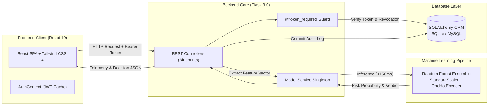

# FraudShield AI – Enterprise Financial Fraud Detection Platform

[](https://www.python.org/)
[](https://flask.palletsprojects.com/)
[](https://react.dev/)
[](https://vitejs.dev/)
[](https://tailwindcss.com/)
[](https://scikit-learn.org/)
[](LICENSE)

**FraudShield AI** is an AI-powered financial transaction surveillance and fraud prevention platform. It ingests digital banking streams, extracts balance-delta anomalies, computes risk probabilities in real time using an ensemble Machine Learning model (`RandomForestClassifier`), flags fraudulent activities with sub-150ms latency, and maintains an immutable cryptographic audit ledger for forensic compliance.

---

## 🚀 Key Features

- **⚡ Real-Time ML Inference**: Scores individual transactions (`TRANSFER`, `CASH_OUT`, `PAYMENT`, `DEBIT`, `CASH_IN`) in under 150ms.
- **📂 Bulk CSV Batch Scanner**: Ingest institutional CSV ledger files with automated schema header detection, interactive scanning progress, and instant verdict classification.
- **🛡️ Multi-Tier Security**: Stateless JWT authentication with Bearer tokens, `HttpOnly` cookie delivery, bcrypt salted password hashing, and server-side token revocation blacklisting.
- **🔄 Dual Database Failover**: Automated socket-based failover between MySQL and a local SQLite database (`fraudshield.db`) without service disruption.
- **📊 Interactive Analytics Dashboard**: Dynamic risk tier classification (Low, Elevated, Critical), payment method distributions, and 7-day risk trend curves powered by Recharts.
- **🔍 Forensic Case Investigation Trace**: Case view with balance delta verification, transaction parameter inspection, and analyst compliance checklists (KYC, balance integrity, velocity).
- **🚨 Threat Alert Center**: Priority queue categorizing anomalies into Critical, High, Medium, and Low severity tiers.
- **⚙️ Model Lifecycle & Hot-Reloading**: In-app decision boundary threshold monitors (50.0% standard cutoff) with dynamic model reload triggers.

---

## 🏗️ System Architecture



---

## 💻 Tech Stack

| Domain | Technologies |
| :--- | :--- |
| **Frontend** | React 19, Vite 8, Tailwind CSS 4, React Router DOM 7, Recharts, Lucide React, Axios |
| **Backend** | Python 3.13, Flask 3.0, Flask-SQLAlchemy 3.1, Flask-CORS, PyJWT, Bcrypt, Gunicorn/WSGI |
| **Machine Learning** | Scikit-Learn (RandomForestClassifier, ColumnTransformer), Pandas, NumPy, Joblib |
| **Database** | SQLite 3 (`fraudshield.db`), MySQL 8 (`fraudshield_db`), SQLAlchemy ORM |

---

## 📁 Repository Structure

```text
FraudShield-AI/
├── backend/
│   ├── database/          # Database connection & auto-seeding
│   ├── models/            # SQLAlchemy models (User, PredictionHistory, RevokedToken)
│   ├── routes/            # Blueprint routes (/api/auth, /api/predict)
│   ├── services/          # ML model loader & prediction evaluation service
│   ├── trained_model/     # Serialized Scikit-Learn artifact (fraud_model.joblib)
│   ├── utils/             # JWT auth decorator & model training scripts
│   ├── .env.example       # Example environment variables
│   ├── app.py             # Flask application factory
│   ├── config.py          # Environment loader & DB failover logic
│   └── requirements.txt   # Python dependencies
│
├── frontend/
│   ├── src/
│   │   ├── assets/        # Visual assets & illustrations
│   │   ├── components/    # Reusable UI (AppLayout, AuthCard)
│   │   ├── context/       # AuthContext for session management
│   │   ├── pages/         # Application pages (Dashboard, Scan, History, Analytics, etc.)
│   │   ├── routes/        # Protected & Public route guards
│   │   ├── services/      # Axios service clients
│   │   └── utils/         # Sound synthesis & storage wrappers
│   ├── package.json       # Frontend dependencies & scripts
│   └── vite.config.js     # Vite configuration
│
└── README.md              # Documentation
```

---

## ⚡ Quick Start Guide

### Prerequisites
- **Python**: 3.10 - 3.13
- **Node.js**: 18.x - 22.x
- **Git**

---

### 1. Clone the Repository
```bash
git clone https://github.com/Priyansi1602/FraudShield-AI.git
cd FraudShield-AI
```

---

### 2. Backend Setup
```bash
cd backend

# Create virtual environment
python -m venv .venv

# Activate virtual environment
# Windows PowerShell:
.\.venv\Scripts\Activate.ps1
# Linux / macOS:
# source .venv/bin/activate

# Install dependencies
pip install -r requirements.txt

# (Optional) Copy example environment configuration
cp .env.example .env

# Start Flask backend server (starts on http://localhost:5000)
python app.py
```

---

### 3. Frontend Setup
```bash
# Open a new terminal
cd frontend

# Install dependencies
npm install

# Start Vite development server (starts on http://localhost:5173)
npm run dev
```

---

## 🔑 Default Analyst Credentials

The application auto-seeds a demonstration fraud analyst account upon first initialization:

- **Email**: `admin@fraudshield.ai`
- **Password**: `admin123`

*(You can also register a new analyst account via the `/signup` screen).*

---

## 📡 API Reference

| Method | Endpoint | Description | Auth Required |
| :--- | :--- | :--- | :---: |
| `GET` | `/api/health` | Service health telemetry | No |
| `POST` | `/api/auth/signup` | Register new analyst account | No |
| `POST` | `/api/auth/login` | Authenticate & receive JWT token | No |
| `POST` | `/api/auth/logout` | Revoke session & blacklist token | No |
| `GET` | `/api/auth/me` | Retrieve active analyst profile | **Yes** (Bearer) |
| `POST` | `/api/predict` | Score single transaction for fraud risk | **Yes** (Bearer) |
| `GET` | `/api/predictions` | Query chronological audit ledger | **Yes** (Bearer) |
| `POST` | `/api/reload-model` | Dynamically reload ML pipeline artifact | **Yes** (Admin Analyst) |

---

## 🌐 Cloud Deployment Guide

### Option 1: 1-Click Blueprint on Render (Recommended)
1. Fork or push this repository to your GitHub account: `https://github.com/Priyansi1602/FraudShield-AI`.
2. Sign in to [Render.com](https://render.com).
3. Click **New +** -> **Blueprint**.
4. Connect this repository and select `render.yaml`.
5. Render will automatically build both the **Backend Web Service** (Gunicorn + Flask) and the **Frontend Static Site** (Vite + React) with zero manual configuration.

---

### Option 2: Render (Backend) + Vercel (Frontend)

#### A. Deploy Backend to Render:
1. On [Render Dashboard](https://dashboard.render.com), click **New +** -> **Web Service**.
2. Connect `https://github.com/Priyansi1602/FraudShield-AI`.
3. Configure settings:
   - **Root Directory**: `backend`
   - **Environment**: `Python 3`
   - **Build Command**: `pip install -r requirements.txt`
   - **Start Command**: `gunicorn wsgi:app`
4. Add Environment Variables:
   - `SECRET_KEY`: *(Generate any random string)*
   - `JWT_SECRET_KEY`: *(Generate any random string)*
   - `JWT_EXPIRY_HOURS`: `24`
   - `DEBUG`: `False`
5. Click **Deploy**. Note your live URL (e.g., `https://fraudshield-backend.onrender.com`).

#### B. Deploy Frontend to Vercel:
1. Sign in to [Vercel](https://vercel.com) and click **Add New** -> **Project**.
2. Import `https://github.com/Priyansi1602/FraudShield-AI`.
3. Configure settings:
   - **Root Directory**: Select `frontend`
   - **Framework Preset**: `Vite`
   - **Build Command**: `npm run build`
   - **Output Directory**: `dist`
4. In **Environment Variables**, add:
   - `VITE_API_URL` = `https://<YOUR-RENDER-BACKEND-URL>/api` (e.g., `https://fraudshield-backend.onrender.com/api`)
5. Click **Deploy**!

---

### Option 3: Docker Deployment
```bash
# Build and run with Docker Compose
docker-compose up --build
```
Access the application on `http://localhost:5000`.

---

## 🧪 Testing

```bash
# Backend unit & integration test
cd backend
python -c "from app import create_app; client = create_app().test_client(); print(client.get('/api/health').get_json())"

# Frontend build & linting
cd frontend
npm run lint
npm run build
```

---

## 🧠 Model Information & Limitations
- **Model Training**: The Scikit-Learn Random Forest pipeline was trained on synthetic transaction data matching Kaggle PaySim feature distributions.
- **Classification Boundary**: Predictions are categorized as `SAFE` or `FRAUD` based on the 50.0% probability threshold.
- **Batch Processing**: CSV scanning executes sequential requests client-side; a dedicated bulk batch endpoint can be introduced for institutional enterprise scale.
- **Academic Demonstration**: This platform serves as a demonstration and portfolio showcase of full-stack AI system design.

---

## 📄 License
This project is licensed under the MIT License - see the [LICENSE](LICENSE) file for details.

---

## 👤 Author
**Priyansi Prajapati**  
GitHub: [@Priyansi1602](https://github.com/Priyansi1602)
